<div align="center">


# AirPointer

**Your Android phone as a touchpad, air mouse and second screen for your computer.**

Point, click, scroll, type and present from the couch. See your computer's screen on the phone and hear its sound.
At home over Wi-Fi, or from anywhere over the internet. No accounts, no router setup, free forever.

[](LICENSE)


[Download](#download) · [Install](#install) · [How to use](#how-to-use) · [Screenshots](#screenshots) · [FAQ](#troubleshooting) · [Support](#support-the-project)

<br>

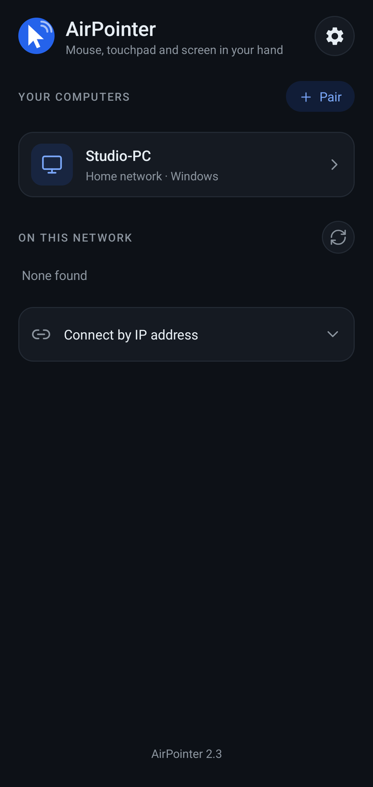&nbsp;
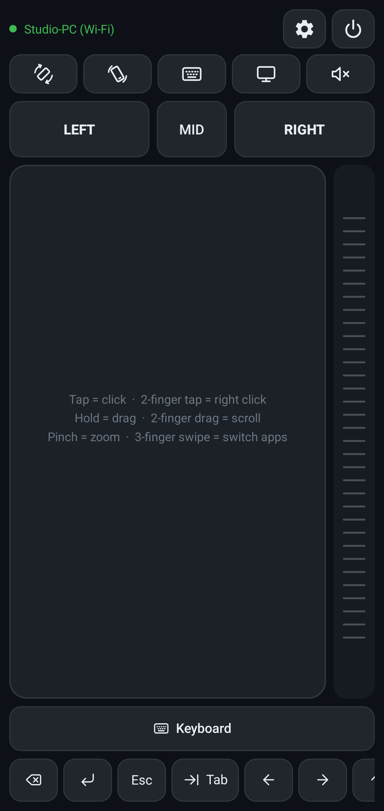&nbsp;
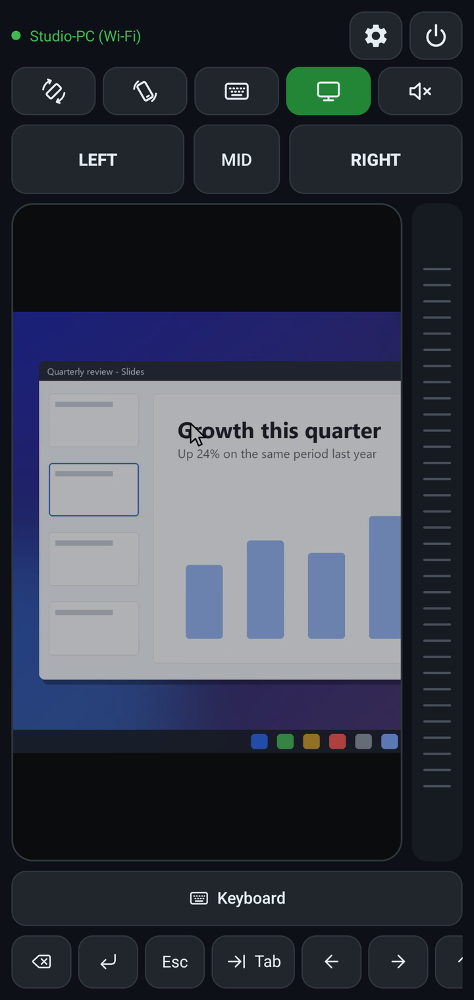&nbsp;
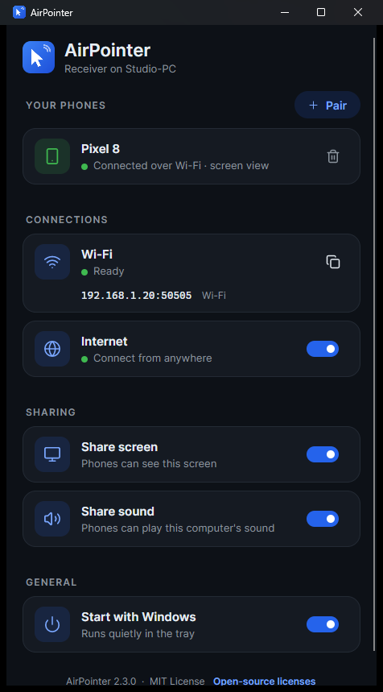

</div>

---

## Features

| | |
|---|---|
| **Touchpad** | Tap to click, two fingers to scroll or right-click, pinch to zoom, three-finger swipes to switch apps. Long-press to drag. |
| **Air mouse** | Point the phone at the screen like a TV remote; the gyroscope moves the cursor. Volume keys click. |
| **Screen view** | See the computer's screen behind the touchpad. It follows the cursor and pinches to zoom. Smooth H.264 video, decoded by the phone's hardware. |
| **Computer sound** | Hear the computer's audio on the phone (Windows and Linux). |
| **Keyboard and shortcuts** | Type with the phone's keyboard. A customizable shortcut bar: 2000+ icons, any key combination or text, presets for media, volume, brightness, slideshows and more. A separate bar for each computer. |
| **Wi-Fi and internet** | Finds your computer on the home network, and connects peer-to-peer over the internet when you're away. No port forwarding, no account. |
| **Secure** | Pair once with a QR code. Every connection is end-to-end encrypted and both sides prove who they are. Only paired phones can connect. |
| **Free and open source** | MIT License. No ads, no tracking, no sign-up. |

## Download

The ready-to-use apps are in the [`dist`](dist) folder of this repository.

| Device | File | Notes |
|---|---|---|
| Android phone (7.0 or newer) | [**AirPointer.apk**](https://github.com/tahaabbas/airpointer/raw/main/dist/AirPointer.apk) | |
| Windows 10 / 11 (64-bit) | [**AirPointer.exe**](https://github.com/tahaabbas/airpointer/raw/main/dist/desktop-win-x64/AirPointer.exe) | Single file, nothing else to install. **Tested.** |
| macOS, Apple Silicon (M1 and newer) | [AirPointer](https://github.com/tahaabbas/airpointer/raw/main/dist/desktop-osx-arm64/AirPointer) | Not tested yet, see [platform status](#platform-status). |
| macOS, Intel | [AirPointer](https://github.com/tahaabbas/airpointer/raw/main/dist/desktop-osx-x64/AirPointer) | Not tested yet. |
| Linux, 64-bit (X11) | [AirPointer](https://github.com/tahaabbas/airpointer/raw/main/dist/desktop-linux-x64/AirPointer) | Not tested yet. |
| iPhone | | In development. |

You need both: the app on your phone, and the app on your computer.

## Install

### Phone (Android)

AirPointer isn't on the Google Play Store yet, so you install the APK file directly, the same way developers install their test builds. Android shows a few warnings for apps from outside the Play Store. That's expected:

1. Download **AirPointer.apk** on the phone (or copy it over from the computer) and tap it.
2. Android asks to **allow installing apps from this source** (your browser or file manager). Allow it, then go back.
3. Tap **Install**.
4. If **Google Play Protect** says *"Unsafe app blocked"* or *"App scan recommended"*, tap **More details → Install anyway** (or *Install without scanning*). Play Protect warns about every app it hasn't seen in the Play Store; it doesn't mean anything was found.
5. Open AirPointer. Allow notifications when asked (so you can see the connection and disconnect from the notification), and allow the camera when you scan the pairing code.

### Windows

1. Download **AirPointer.exe** and run it. You don't need to install anything else.
2. Windows SmartScreen may say *"Windows protected your PC"* because the app isn't code-signed yet. Click **More info → Run anyway**.
3. When Windows Firewall asks, allow access on **Private networks** (and Public too, if your home Wi-Fi is set to Public). Without this the phone can't find the computer.
4. Optional: turn on **Start with Windows** in the app. Closing the window keeps AirPointer running in the tray; right-click the tray icon to quit.

### macOS (untested)

1. Download the file for your Mac (Apple Silicon or Intel). In Terminal, in the download folder:
   ```bash
   chmod +x AirPointer
   xattr -d com.apple.quarantine AirPointer
   codesign --force -s - AirPointer
   ./AirPointer
   ```
   The app isn't signed by Apple, so these steps tell macOS to run it anyway.
2. Allow AirPointer under **System Settings → Privacy & Security → Accessibility** (to move the mouse) and **Screen Recording** (for screen view).

### Linux (untested)

```bash
chmod +x AirPointer
./AirPointer
```
It needs an **X11** session (on Wayland, pick "GNOME on Xorg" or similar at login). Computer sound needs `parec` (PulseAudio or PipeWire). On a machine without a desktop, `./AirPointer --headless --pair` runs it in the terminal and prints the pairing QR code there.

## How to use

**1. Pair once** (phone and computer on the same Wi-Fi)

- On the computer, click **+ Pair**. A QR code appears.
- On the phone, tap **Scan pairing code** and point the camera at it.

The phone connects straight away. The code works once and expires after 5 minutes.

**2. Connect any time**

Open AirPointer on the phone and tap your computer under *Your computers*. At home it connects over Wi-Fi; away from home it connects over the internet automatically.

**3. Control**

| Gesture / button | Does |
|---|---|
| 1 finger | Move the cursor (quick flicks travel further) |
| Tap / double tap | Left click / double click |
| Long-press, then move | Drag |
| 2-finger tap | Right click |
| 2-finger drag, or the strip on the right | Scroll |
| Pinch | Zoom (or zoom the screen picture, when screen view is on) |
| 3-finger tap | Middle click |
| 3-finger swipe | Up: task view · Down: desktop · Left / right: switch apps |
| LEFT / MID / RIGHT | Mouse buttons (hold one to drag) |
| Volume up / down | Left / right click (can be turned off in Settings) |

**Toolbar:**
- First row: the connected computer, Settings, Disconnect.
- Second row: rotate (portrait or landscape), air mouse, keyboard, screen view, computer sound.

**Air mouse:** turn it on and hold the phone like a TV remote, top edge toward the screen. Turn left and right to move sideways, tilt up and down to move up and down. Clicking freezes the cursor for a moment so it doesn't jump. Turn it off before you put the phone down.

**Screen view:** shows the computer's screen behind the touchpad. The touchpad still works as usual; the picture slides along when the cursor nears an edge, and pinching zooms it. In Settings → *Screen* you can choose quality, frame rate, zoom and how see-through the touchpad is. On the computer, *Share screen* and *Share sound* can each be switched off.

**Shortcut bar:** the row of buttons at the bottom. Tap **+** at its end, or open Settings → *Shortcut buttons*.
- Add buttons with an icon, a label, or both. A button presses keys or types text:
  - `Ctrl+C`: keys pressed together.
  - `Ctrl+C, Ctrl+V`: keys pressed one after another.
- Drag the handle to reorder. Presets include media keys, volume, brightness, Wi-Fi and airplane mode, lock, screenshots, task view and slideshow controls.
- Every computer has its own bar, and a Mac starts with Mac shortcuts (Cmd instead of Ctrl).

## Screenshots

<table>
<tr>
<td align="center">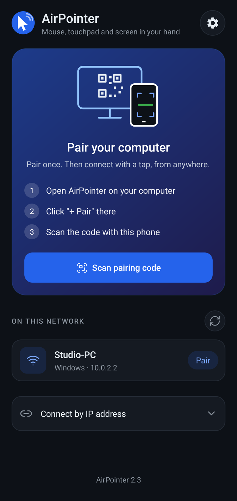<br><sub>First start</sub></td>
<td align="center"><br><sub>Your computers</sub></td>
<td align="center"><br><sub>Touchpad</sub></td>
</tr>
<tr>
<td align="center"><br><sub>Screen view</sub></td>
<td align="center">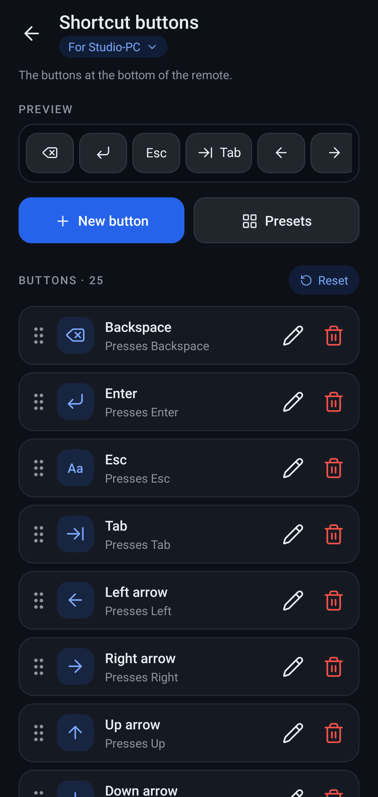<br><sub>Shortcut buttons</sub></td>
<td align="center">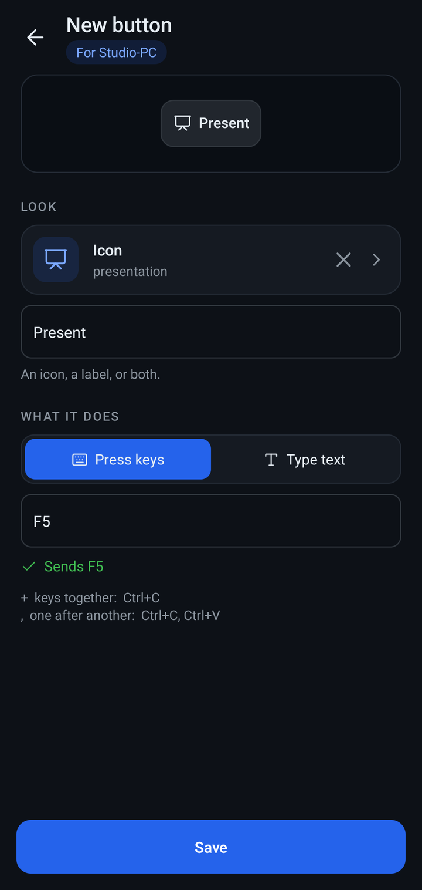<br><sub>Button editor</sub></td>
</tr>
<tr>
<td align="center">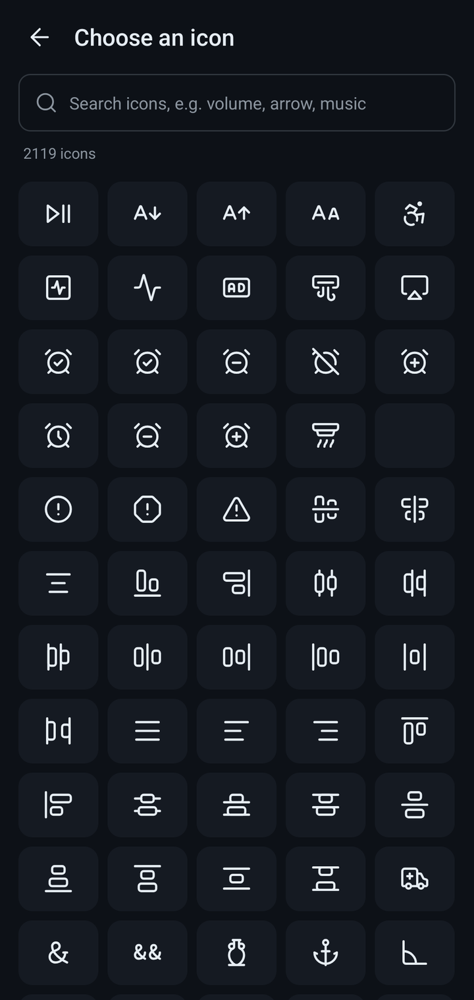<br><sub>2000+ icons</sub></td>
<td align="center">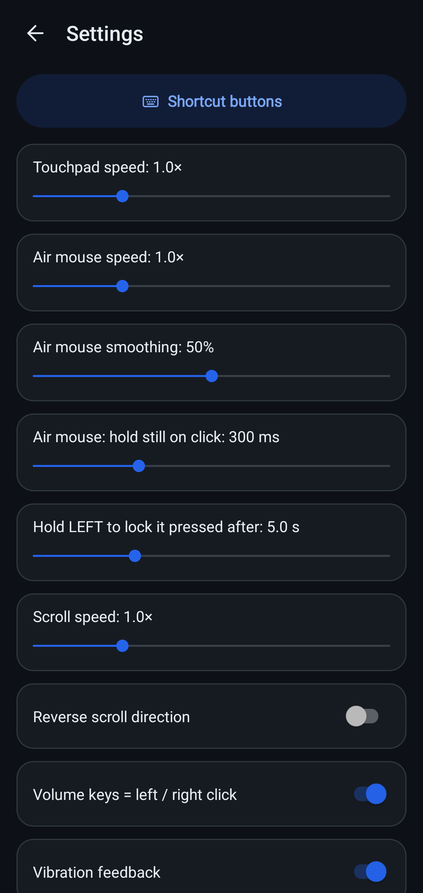<br><sub>Settings</sub></td>
<td align="center">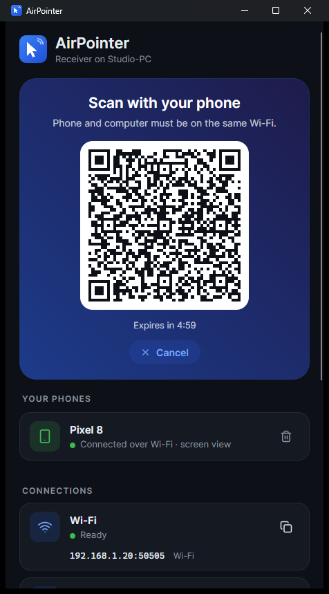<br><sub>Computer: pairing code</sub></td>
</tr>
</table>

<p align="center">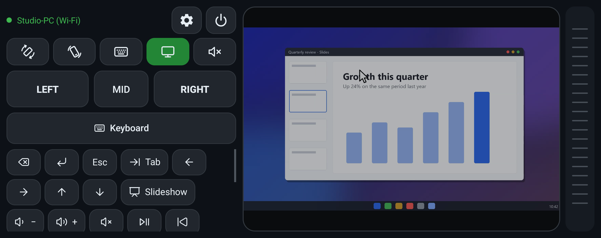<br><sub>Landscape: controls on one side, the computer screen on the other</sub></p>

<p align="center">
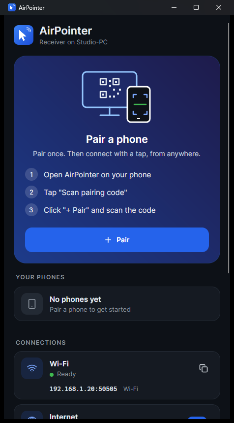&nbsp;&nbsp;
<br>
<sub>The computer app: first start, and with a phone connected</sub>
</p>

## Platform status

| Platform | Status |
|---|---|
| **Windows 10 / 11** | Fully tested. Everything works: touchpad, air mouse, keyboard, shortcuts, screen view (H.264), computer sound, internet connections. |
| **Android phones** | Tested. Runs on Android 7.0 and newer (arm64 and armv7 phones). |
| **macOS** | **Not tested.** We have never run AirPointer on a Mac as the computer. It's built from the same code and libraries as the Windows app, so we expect it to work, but we can't promise it. Internet connections and computer sound aren't available on macOS yet. |
| **Linux** | **Not tested**, for the same reason. Needs X11. Internet connections aren't available on Linux yet. |
| **iPhone** | An iPhone app is in development. |

**If you try AirPointer on macOS or Linux, please tell us how it went**, good or bad, in the [Issues](https://github.com/tahaabbas/airpointer/issues) section. There's a ready-made *macOS / Linux report* form. Your reports are what will make it work well there.

## Privacy and security

- **No accounts, no cloud, no tracking.** AirPointer doesn't collect anything.
- **Pairing with a QR code.** Each phone and computer has its own key pair; the phone's key lives in the Android Keystore and can't be copied. The QR code carries the computer's key fingerprint and a one-time code that expires after 5 minutes. Only paired phones can connect.
- **End-to-end encrypted.** On Wi-Fi, every connection (control, screen, sound) uses TLS, and the phone accepts only the exact key of the computer it paired with. Over the internet, connections use [iroh](https://iroh.computer) (QUIC with TLS 1.3). They go directly phone to computer when possible, otherwise through a free public relay that only ever sees encrypted data. The computer never opens a port.
- **Both sides prove who they are** on every connection by signing each other's random challenge.
- **You stay in control.** Remove a phone in the computer app and it can no longer connect. Switch off screen sharing, sound sharing or internet connections on the computer at any time.

## Troubleshooting

<details>
<summary><b>The phone doesn't find the computer</b></summary>

Both must be on the same network, and the computer's firewall must allow AirPointer. Some networks (guest Wi-Fi, "AP isolation") block devices from seeing each other. In that case, open *Connect by IP address* on the phone and type the address shown in the computer app. To redo the Windows firewall choice: *Windows Security → Firewall → Allow an app through firewall*, then tick AirPointer.
</details>

<details>
<summary><b>The QR code doesn't scan</b></summary>

Make the window bigger and avoid glare; the phone's own camera app can scan it too (it opens AirPointer). Codes expire after 5 minutes. Click **+ Pair** again for a new one.
</details>

<details>
<summary><b>"Not paired with this computer"</b></summary>

The phone was removed in the computer app, or the computer app was reset. Pair again with a new QR code.
</details>

<details>
<summary><b>Can't click in some windows (Task Manager, installers)</b></summary>

Windows blocks normal apps from controlling windows that run as administrator. Run AirPointer as administrator if you need that.
</details>

<details>
<summary><b>Air mouse drifts or shakes</b></summary>

Raise *Air mouse smoothing* in Settings. When the phone is held still the cursor stops.
</details>

<details>
<summary><b>Screen view is choppy</b></summary>

Choose *Performance* or a lower frame rate in Settings → Screen. On Linux and macOS, turn on **Smooth video** in the computer app: it sends H.264 video instead of images and needs far less data.
</details>

<details>
<summary><b>Where are the computer app's settings and log?</b></summary>

In `%APPDATA%\AirPointer` on Windows, and `~/.config/AirPointer` on Linux and macOS (`config.json`, `airpointer.log`, and the computer's keys).
</details>

## Build from source

<details>
<summary><b>Computer app</b> (C#, .NET 10, Avalonia: one codebase for Windows, macOS and Linux)</summary>

```bash
cd desktop/AirPointer
dotnet publish -c Release -f net10.0-windows10.0.19041.0 -r win-x64 --self-contained -p:PublishSingleFile=true -p:IncludeNativeLibrariesForSelfExtract=true -p:EnableCompressionInSingleFile=true -p:DebugType=none -o out
```

- **Other platforms:** use `-f net10.0` with `-r linux-x64`, `osx-arm64` or `osx-x64`.
- **Test settings:**
  - `AIRPOINTER_HOME=<folder>` keeps the config, keys and log in that folder.
  - `AIRPOINTER_TEST_SCREEN=<image>` makes screen view show that image instead of the real screen.
  - `AIRPOINTER_NAME=<name>` changes the computer's name shown on phones.
</details>

<details>
<summary><b>Phone app</b> (Kotlin, JDK 17, Android SDK)</summary>

```bash
cd android
./gradlew assembleRelease
```

- **Emulator:** add `-PwithEmulatorAbi` to include the x86_64 library.
- **Signing:** release builds are signed with the key in `android/keystore.properties`. That file and the keystore are not in this repository; without them, builds use the debug key.
</details>

<details>
<summary><b>Internet library</b> (Rust + iroh, <code>native/airlink</code>)</summary>

The built libraries are already in the repository (`desktop/AirPointer/native/`, `android/app/src/main/jniLibs/`). To rebuild them:

- **Needs:** Rust 1.91+, and for Android the Rust Android targets, `cargo-ndk` and `ANDROID_NDK_HOME`.

```bash
native/airlink/build.sh            # windows | linux | android | all
```
</details>

<details>
<summary><b>Project layout and protocol</b></summary>

```
desktop/AirPointer/      computer app: Core/ (protocol, pairing, servers, sessions), Media/ (screen and sound capture,
                         H.264), Input/ (mouse and keyboard per OS), MainWindow.cs + Ui.cs (the window)
android/app/             phone app: MainActivity (connect), RemoteActivity (touchpad), ScreenView + VideoDecoder,
                         ShortcutsActivity / EditShortcutActivity / IconPickerActivity, Secure.kt (keys, TLS, pairing)
native/airlink/          Rust: internet connections (iroh) for both apps, and the Windows H.264 encoder
dist/                    ready-built apps
licenses/                third-party licenses and notices
tools/                   third_party_notices.py (regenerates licenses/THIRD-PARTY-NOTICES.txt)
screenshots/             the pictures in this README
```

**Protocol (version 5):**
- **Framing:** `[u16 length][u8 type][payload]` over TLS on TCP port 50505.
- **Handshake:** each connection starts `Hello` → `AuthChallenge` → `AuthResponse` → `Welcome`. Pairing is one `PairRequest` → `PairResult` exchange.
- **Discovery:** UDP port 50506.
- **Screen and sound:** each uses its own connection with large frames `[u32 length][u8 type][payload]`: H.264 (`VideoFormat`, `VideoFrame`) or JPEG, cursor positions, and 16-bit PCM audio.
- **Over the internet:** the same frames run inside an iroh QUIC stream (ALPN `airpointer/1`).

See `Protocol.cs` / `Protocol.kt` for the full list.
</details>

## License

AirPointer is **free and open source** under the [MIT License](LICENSE). You may use it, copy it, change it, share it and build on it, for personal or commercial use. Just keep the copyright and license notice. It comes without any warranty.

AirPointer is built on other open-source work, each used under its own license:

| Component | Used for | License |
|---|---|---|
| [Lucide](https://lucide.dev) | Icons in both apps | ISC (some icons MIT, from Feather) |
| [iroh](https://iroh.computer) and its Rust dependencies | Internet connections | MIT / Apache-2.0 (and other permissive licenses) |
| [Avalonia](https://avaloniaui.net), SkiaSharp, HarfBuzzSharp | Computer app interface | MIT |
| .NET runtime | Computer app | MIT |
| QRCoder, SharpZipLib, Tmds.DBus | QR codes, unpacking, Linux desktop integration | MIT |
| Inter typeface | Computer app font | SIL Open Font License 1.1 |
| [ZXing](https://github.com/zxing/zxing), Kotlin standard library | QR scanning, phone app | Apache-2.0 |
| [OpenH264](https://www.openh264.org) by Cisco | Optional *Smooth video* on Linux and macOS | Cisco's binary license, **not included** (see below) |

**About video encoding:**
- AirPointer does **not** use FFmpeg.
- **Windows:** the built-in Media Foundation encoder produces H.264 video.
- **Linux and macOS:** H.264 comes from the *OpenH264 Video Codec provided by Cisco Systems, Inc.* It isn't bundled with AirPointer.
  - It's only downloaded, directly from Cisco, if you turn on *Smooth video*.
  - The download is checked against the exact release AirPointer was tested with.
  - Cisco's license applies to it ([`licenses/OpenH264-BINARY_LICENSE.txt`](licenses/OpenH264-BINARY_LICENSE.txt), also shown in the app), and Cisco pays the H.264 patent royalties for that binary.

**Full notices:**
- Every bundled component, with its license text, is listed in [`licenses/THIRD-PARTY-NOTICES.txt`](licenses/THIRD-PARTY-NOTICES.txt), generated from the actual dependency lists.
- Both apps also show the notices: *Settings → Open-source licenses* on the phone, *Open-source licenses* at the bottom of the computer app.

Windows, macOS, Linux, Android, iPhone and other names are trademarks of their respective owners. AirPointer is an independent project and isn't affiliated with or endorsed by them.

## Support the project

AirPointer is free, and we'd like to keep it that way. If it's useful to you:

- **Star this repository.** It helps others find it.
- **Report bugs and test results** in [Issues](https://github.com/tahaabbas/airpointer/issues). macOS and Linux reports are especially welcome.
- **Share it** with someone who presents, streams or controls a media PC from the couch.
- **Donations** will be possible soon through the **Sponsor** button at the top of this page.

## Contributing

Pull requests are welcome. For bigger changes, please open an issue first so we can talk it through. By contributing you agree that your contribution is licensed under the MIT License.
